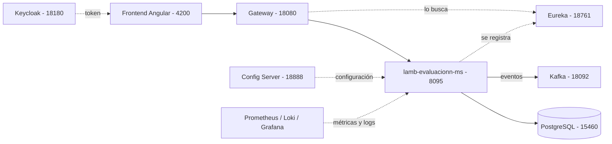

# S1 - Construcción de un servicio base para un sistema distribuido

*Guía única: agregar un microservicio nuevo al proyecto Lamb - Parte 1 de 16 - 2026*

!!! note "Antes de empezar: debe estar levantado"
    Abre **Docker Desktop** (debe decir *Engine running*) y haz la verificación de la [sección 1.5](#15-verifica-tu-computadora-antes-de-todo). En esta sesión todavía no se arranca ningún servicio.

## 0. Liberar todos los puertos (antes de empezar)

Si te sale **`Port 18888 was already in use`** (o cualquier puerto), es porque algo de Lamb ya quedó corriendo:
otra terminal, un `java -jar` o **otra copia del proyecto**. Haz esto antes de crear o arrancar un servicio,
así empiezas limpio.

**Dónde abrir la terminal:** cualquier PowerShell (no importa la carpeta).  
**Qué hace:** apaga todo lo que use los puertos de Lamb. Los programas (`java`, `node`) los cierra, y los
contenedores de Docker (BD, Kafka, Keycloak, Grafana) los detiene **sin** cerrar Docker Desktop.  
**Y pega el siguiente código:**

```powershell
$puertos = @(4200, 8095, 8096, 13000, 13100, 18080, 18090, 18092, 18180, 18761, 18888, 19090) + (8081..8089) + (15451..15460)
foreach ($p in $puertos) {
    $c = Get-NetTCPConnection -LocalPort $p -State Listen -ErrorAction SilentlyContinue | Select-Object -First 1
    if (-not $c) { continue }
    $proc = Get-Process -Id $c.OwningProcess -ErrorAction SilentlyContinue
    if ($proc.ProcessName -match '^(com\.docker\.backend|wslrelay|vpnkit|docker)') {
        docker ps -q --filter "publish=$p" | ForEach-Object { docker stop $_ | Out-Null }
        "[LIBERADO] $p  (contenedor de Docker)"
    } else {
        Stop-Process -Id $c.OwningProcess -Force
        "[LIBERADO] $p  ($($proc.ProcessName))"
    }
}
"Listo: puertos libres."
```

Si un puerto estaba ocupado, sale `[LIBERADO] 18888  (java)`. Si no sale ninguna línea `[LIBERADO]`, ya estaban todos libres.

!!! note "Si tu servicio usa otro puerto"
    Agrega tu puerto a la primera línea (ej. si elegiste `8097` y `15461`, ponlos dentro de `@( ... )`).
    Los contenedores de Docker se vuelven a levantar con su `docker compose ... up -d` de cada sesión.

!!! note "Arranca siempre desde esta carpeta"
    Después de liberar, arranca Config, Eureka, tu servicio y el Gateway desde **esta** copia del proyecto.
    Si tienes otra copia de Lamb en tu PC y la arrancas, su Config Server **no ve** los archivos que creas aquí.

## 1. Introducción

### 1.1 Qué es esta guía

Esta es **una sola guía**, repartida en las sesiones del curso, para agregar **cualquier microservicio nuevo**
al proyecto Lamb (Admisión + Trayectoria) conectado a todo: Config Server, Eureka, Gateway, Keycloak,
PostgreSQL, Kafka, Prometheus, Loki, Grafana y un frontend Angular simple, **sin diseño**.
El código sigue el mismo estilo que el proyecto `pagatu` (entidad, DTO, mapper MapStruct, servicio,
controlador, `CorrelationIdFilter`, productor/consumidor Kafka).

Todo el código fue ejecutado y probado. El ejemplo es un servicio **`lamb-evaluacionn-ms`** con un CRUD de **examenes**.

### 1.2 Elige tu camino

En cada sesión vas a encontrar dos caminos. Elige **uno** al inicio y síguelo hasta el final:

| Camino | Cuándo elegirlo | Qué obtienes al final |
|---|---|---|
| **A - Sin CRUD** | El profe pide "un servicio conectado a todo", sin lógica ni tablas | Página "Hola mundo" + botón que manda un evento a Kafka |
| **B - Con CRUD** | El profe pide registrar algo (examenes, pagos, alumnos...): agregar, editar, eliminar | Lo del camino A + lista y formulario para agregar, editar y eliminar |

!!! note "Cómo se ve en cada sesión"
    - Lo que está fuera de los caminos es **común**: hazlo siempre.
    - Si una sección dice **Camino A - Sin CRUD**, hazla solo si elegiste A.
    - Si una sección dice **Camino B - Con CRUD**, hazla solo si elegiste B.

!!! note "Si te sale un error"
    Busca el mensaje en [Solución de errores](Solucion_Errores.md): dice qué archivo abrir y qué cambiar
    (puertos ocupados, base de datos, Gateway, Keycloak, Kafka, Angular...). Todos los links están en
    [Enlaces del sistema](Enlaces_Sistema.md).

!!! note "Si ya sabes y solo quieres copiar"
    En [Resumen rápido](Resumen_Rapido.md) están todos los archivos, con la sesión donde está su versión final.

**Cómo seguir los pasos:** cada paso dice qué archivo **crear**, **modificar** o **reemplazar**, con su ruta completa desde la raíz del proyecto (`Lamb-Modulo02-Admision-Trayectoria`, la carpeta que abres en VS Code). Para crear un archivo: clic derecho en la carpeta → *New File*. Para abrir una terminal en la raíz: *Terminal → New Terminal*.

### 1.3 Mapa de la guía

| Sesión | Qué agregas a tu servicio |
|---|---|
| S1 | Proyecto, código base, tabla y CRUD (camino B), base de datos en Docker |
| S2 | Configuración en el Config Server |
| S3 | Registro en Eureka y varias instancias |
| S4 | Ruta en el Gateway (`http://localhost:18080`) |
| S5 | Evaluación U1: evidencias |
| S6 | (Opcional) Llamar a otro microservicio |
| S7 / S7b | Seguridad: roles en el Gateway con Keycloak |
| S8 | Kafka: enviar y recibir eventos |
| S9 | Consistencia: publicar solo si se guardó |
| S10 | Logs y métricas en Grafana |
| S11 | Frontend Angular sin diseño |
| S12 | Evaluación U2: evidencias |
| S13 | Prueba completa de punta a punta |
| S14 | Problemas comunes y cómo adaptarlo a otro caso |
| S15 / S16 | Demostración y preguntas técnicas |

### 1.4 Dónde queda tu servicio



### 1.5 Verifica tu computadora (antes de todo)

Hazlo **una sola vez** antes de empezar: así evitas errores más adelante.

| Herramienta | Versión | Para qué | Si falta |
|---|---|---|---|
| **Java JDK** | **21** | Compilar y correr los servicios | Instala *Eclipse Temurin 21* (en el instalador activa **Set JAVA_HOME variable**) |
| **JAVA_HOME** | apuntando al JDK 21 | `mvnw` la usa para compilar | Ver "Configurar JAVA_HOME" abajo |
| **Docker Desktop** | con Docker Compose v2+ | BD, Kafka, Keycloak, Grafana... | Instala Docker Desktop (te pedirá activar **WSL 2**: acepta y reinicia) |
| **Node.js** | 20.19+, 22.12+ o 24 (LTS) | Frontend Angular 21 | Instala *Node.js LTS* (trae npm) |
| **npm** | viene con Node.js | Instalar y correr el frontend | — |
| **Git** | cualquiera | Clonar y subir el proyecto | Instala *Git for Windows* |
| **Maven** | no hace falta | `mvnw.cmd` lo descarga solo | — |
| **RAM** | 16 GB recomendado (8 GB mínimo) | Todo corre en tu PC | Con 8 GB levanta solo lo necesario |
| **Internet** | la primera vez | Descargar librerías e imágenes de Docker | — |

**1. Pega esto en PowerShell** (revisa todo de una vez):

**Dónde abrir la terminal:** Cualquier PowerShell (no importa la carpeta). Pega todo el bloque de una vez y pulsa `Enter`.

```powershell
$script:faltan = 0
function Revisar($nombre, [scriptblock]$comando, $esperado, $solucion) {
    try { $salida = (& $comando 2>&1 | Out-String).Trim() } catch { $salida = "" }
    if ($salida -match $esperado) {
        Write-Host ("[OK]    {0,-18} {1}" -f $nombre, (($salida -split "`n")[0].Trim() -replace '^\S+ : ', ''))
    } else {
        Write-Host ("[FALTA] {0,-18} {1}" -f $nombre, $solucion)
        $script:faltan++
    }
}
Revisar "Java 21"          { java -version }  'version "21\.'  "Instala el JDK 21 (Temurin) y vuelve a abrir la terminal"
Revisar "JAVA_HOME (21)"   { & "$env:JAVA_HOME\bin\java.exe" -version } 'version "21\.' "La variable JAVA_HOME debe apuntar a la carpeta del JDK 21"
Revisar "Docker"           { docker --version } 'Docker version' "Instala Docker Desktop"
Revisar "Docker encendido" { docker info --format '{{.ServerVersion}}' } '^\d' "Abre Docker Desktop y espera 'Engine running'"
Revisar "Docker Compose"   { docker compose version } 'version v\d' "Actualiza Docker Desktop"
Revisar "Node.js"          { node -v } '^v(20\.(19|[2-9]\d)|22\.(1[2-9]|[2-9]\d)|2[4-9]|[3-9]\d)\.' "Instala Node.js 22 o 24 (LTS)"
Revisar "npm"              { npm -v } '^\d+\.' "Viene con Node.js: reinstala Node.js"
Revisar "Git"              { git --version } 'git version' "Instala Git para Windows"
Revisar "Permiso scripts"  { Get-ExecutionPolicy } 'RemoteSigned|Unrestricted|Bypass' "Ejecuta: Set-ExecutionPolicy -Scope CurrentUser RemoteSigned"
$ram = [math]::Round((Get-CimInstance Win32_ComputerSystem).TotalPhysicalMemory / 1GB)
if ($ram -ge 16) { Write-Host ("[OK]    {0,-18} {1} GB" -f "Memoria RAM", $ram) }
else { Write-Host ("[AVISO] {0,-18} {1} GB: levanta solo lo necesario (ver Solucion de errores, seccion 11)" -f "Memoria RAM", $ram) }
if ($script:faltan -eq 0) { Write-Host "`nTodo listo." } else { Write-Host "`nFaltan $($script:faltan) cosas: arreglalas antes de seguir." }
```

Debe terminar en **`Todo listo.`** Si alguna línea dice **`[FALTA]`**, haz lo que indica, **cierra y vuelve a abrir
PowerShell** y pégalo otra vez. Así se ve cuando todo está bien:

```text
[OK]    Java 21            openjdk version "21.0.12" 2026-07-21 LTS
[OK]    JAVA_HOME (21)     openjdk version "21.0.12" 2026-07-21 LTS
[OK]    Docker             Docker version 29.7.2, build a7dcaa6
[OK]    Docker encendido   29.7.2
[OK]    Docker Compose     Docker Compose version v5.5.0
[OK]    Node.js            v24.15.0
[OK]    npm                11.12.1
[OK]    Git                git version 2.54.0.windows.1
[OK]    Permiso scripts    RemoteSigned
[OK]    Memoria RAM        16 GB

Todo listo.
```

Tus números pueden ser otros: lo importante es que todo diga `[OK]`.

**Angular** no se instala aparte: viene dentro del proyecto. Compruébalo (la primera vez tarda, descarga librerías):

**Dónde abrir la terminal:** En la **raíz del proyecto** (`Lamb-Modulo02-Admision-Trayectoria`). El bloque entra a `clients\lamb-frontend` y al final vuelve a la raíz.

```powershell
cd clients\lamb-frontend
npm install
npx ng version          # debe decir Angular CLI: 21.x y Node: 20.19+, 22.12+ o 24.x
cd ..\..
```

**2. Revisa que los puertos estén libres:**

```powershell
foreach ($p in 4200, 8095, 13000, 13100, 15460, 18080, 18090, 18092, 18180, 18761, 18888, 19090) {
    $c = Get-NetTCPConnection -LocalPort $p -State Listen -ErrorAction SilentlyContinue | Select-Object -First 1
    if ($c) { "[OCUPADO] $p  -> lo usa: $((Get-Process -Id $c.OwningProcess).ProcessName)" } else { "[LIBRE]   $p" }
}
```

Si **ya tienes Lamb levantado**, es normal que salgan ocupados (por `java`, `node`, `wslrelay` o `com.docker.backend`). Si **no** lo tienes levantado y sale `[OCUPADO]`, ciérralo o cambia de puerto: ver [Solución de errores, sección 2](Solucion_Errores.md#2-puertos-ocupados). El `8095` y el `15460` son los de tu servicio nuevo: si están ocupados, elige otros en la sección 2.

!!! note "Configurar JAVA_HOME (si salió [FALTA])"
    1. Busca la carpeta del JDK 21: normalmente `C:\Program Files\Eclipse Adoptium\jdk-21...`
    2. Menú inicio → escribe **variables de entorno** → *Editar las variables de entorno del sistema* → *Variables de entorno*.
    3. En *Variables de usuario* → *Nueva*: nombre `JAVA_HOME`, valor la carpeta del paso 1 (sin `\bin`).
    4. En la misma lista edita `Path` → *Nuevo* → `%JAVA_HOME%\bin` → súbelo arriba de todo.
    5. Acepta, **cierra todas las terminales** (y VS Code) y vuelve a abrirlas.

!!! note "Si algo sigue fallando"
    Busca el mensaje en [Solución de errores](Solucion_Errores.md).

## 2. Elige tus nombres

Toda la guía usa **evaluacionn** y **examen**. Antes de empezar, decide tus nombres según lo que te pidan
y reemplázalos **en todos los pasos** (en VS Code: `Ctrl+Shift+H`, respetando mayúsculas).

| En la guía dice | Lo cambias por (ej. te piden "Tesorería" con "Pagos") | Se usa en |
|---|---|---|
| `evaluacionn` | `tesoreria` | carpeta, paquete Java, rutas, BD, topic Kafka |
| `Evaluacionn` | `Tesoreria` | nombres de clases Java |
| `examen` / `examenes` (camino B) | `pago` / `pagos` | variables, tabla, ruta `/api/v1/pagos` |
| `Examen` (camino B) | `Pago` | clases Java (`Pago`, `PagoRequest`...) |
| `titulo`, `curso` (camino B) | los atributos que te pidan | tabla, entidad, DTOs, formulario |
| `8095` | un puerto libre | puerto del servicio |
| `15460` | otro puerto libre (15461, 15462...) | puerto de su PostgreSQL |

!!! note "Esto NO se cambia"
    Los puertos de Lamb (`18888` Config, `18761` Eureka, `18080` Gateway, `18092` Kafka, `18180` Keycloak),
    el prefijo `pe.edu.upeu.lamb`, el prefijo de rutas `/api/v1/`, los nombres de las clases de infraestructura
    (`CorrelationIdFilter`, `GlobalExceptionHandler`, `ResourceNotFoundException`, `OpenApiConfig`...) y el
    contenido de los archivos que la guía marca como "copia tal cual".

**Puertos ocupados en Lamb:** 8081–8089, 15451–15459, 18080, 18090, 18092, 18180, 18761, 18888.
Revisa que tu puerto esté libre (si **no imprime nada**, está libre):

```powershell
Get-NetTCPConnection -LocalPort 8095 -State Listen -ErrorAction SilentlyContinue
```

## 3. Crear el proyecto

Aquí **no creas archivos a mano**: un comando crea la carpeta del servicio y sus subcarpetas, y copia
el `pom.xml` y el Maven Wrapper de Trayectoria, que ya traen todas las dependencias
(web, JPA, Flyway, Kafka, seguridad OAuth2, Config, Eureka, Swagger, Actuator, Prometheus, Lombok).

**Dónde abrir la terminal:** En la **raíz del proyecto** (`Lamb-Modulo02-Admision-Trayectoria`). En VS Code: *Terminal → New Terminal*. **Comprueba** que estás en la raíz: escribe `ls` y deben salir las carpetas `services`, `infra`, `clients`, `kafka`, `keycloak`, `obs`. Pega todo el bloque de una vez y pulsa `Enter`. Si no sale nada, está bien.

```powershell
$nuevo = "services\lamb-evaluacionn-ms"                              # cambia por tu nombre
$java  = "$nuevo\src\main\java\pe\edu\upeu\lamb\evaluacionn"        # cambia por tu nombre
New-Item -ItemType Directory $nuevo | Out-Null
Copy-Item -Recurse services\lamb-trayectoria-ms\.mvn $nuevo
Copy-Item services\lamb-trayectoria-ms\mvnw, services\lamb-trayectoria-ms\mvnw.cmd, services\lamb-trayectoria-ms\pom.xml, services\lamb-trayectoria-ms\.gitignore $nuevo
(Get-Content "$nuevo\pom.xml") -replace 'lamb-trayectoria-ms','lamb-evaluacionn-ms' -replace '<description>.*</description>','<description>Microservicio de evaluacionn</description>' | Set-Content -Encoding utf8 "$nuevo\pom.xml"
"config","controller","filter" | ForEach-Object { New-Item -ItemType Directory -Force "$java\$_" | Out-Null }
New-Item -ItemType Directory -Force "$nuevo\src\main\resources\db\migration" | Out-Null
```

!!! note "Solo cambian las 2 primeras líneas y `lamb-evaluacionn-ms` / `evaluacionn` del `-replace`"
    El resto del bloque se pega tal cual.

**Camino B - Con CRUD:** crea además estas carpetas (en **la misma terminal**, justo después del bloque anterior,
porque usa la variable `$java`):

```powershell
"dto","entity","exception","mapper","repository","service" | ForEach-Object { New-Item -ItemType Directory -Force "$java\$_" | Out-Null }
```

**Resultado:** en VS Code (panel izquierdo, *Explorer*) debe aparecer esto. Las carpetas están **vacías**: los
archivos `.java` los creas tú en los pasos siguientes.

```text
Lamb-Modulo02-Admision-Trayectoria\              <- raíz (la carpeta abierta en VS Code)
└── services\
    └── lamb-evaluacionn-ms\                      <- tu servicio (NUEVO)
        ├── .mvn\                                <- copiado (no lo toques)
        ├── mvnw, mvnw.cmd, pom.xml, .gitignore  <- copiados
        └── src\main\
            ├── java\pe\edu\upeu\lamb\evaluacionn\  <- AQUÍ van los .java
            │   ├── config\
            │   ├── controller\
            │   ├── filter\
            │   └── dto\ entity\ exception\ mapper\ repository\ service\   (solo camino B)
            └── resources\                       <- AQUÍ van .yml, .xml y .sql
                └── db\migration\
```

!!! note "En VS Code las carpetas salen juntas"
    VS Code muestra `java\pe\edu\upeu\lamb\evaluacionn` en **una sola línea** (`java/pe/edu/upeu/lamb/evaluacionn`).
    Es normal: haz clic derecho sobre esa línea para crear archivos dentro de `evaluacionn`.

## 4. Código común (los dos caminos)

Todos los archivos Java van dentro de `services\lamb-evaluacionn-ms\src\main\java\pe\edu\upeu\lamb\evaluacionn\`
(o en una de sus subcarpetas: `config\`, `controller\`...). Cada paso te dice cuál.

### 4.1 `LambEvaluacionnMsApplication.java`

**Crea el archivo:** `LambEvaluacionnMsApplication.java`  
**En la ruta:** `services\lamb-evaluacionn-ms\src\main\java\pe\edu\upeu\lamb\evaluacionn\`  
**Cómo:** clic derecho en la carpeta `evaluacionn` → **New File** (es un archivo, no una carpeta) → escribe el nombre exacto.  
**Y pega el siguiente código:**

{{lamb:services/lamb-biblioteca-ms/src/main/java/pe/edu/upeu/lamb/biblioteca/LambBibliotecaMsApplication.java}}

!!! note "Qué cambia"
    El `package` (tu nombre) y el nombre de la clase (`Lamb` + `TuServicio` + `MsApplication`). Nada más.

### 4.2 `config\SecurityConfig.java` (por ahora todo abierto)

Igual que Admisión y Trayectoria en desarrollo: todo abierto. En la **S7** se cambia por la versión con Keycloak.

**Crea el archivo:** `SecurityConfig.java`  
**En la ruta:** `services\lamb-evaluacionn-ms\src\main\java\pe\edu\upeu\lamb\evaluacionn\config\`  
**Cómo:** clic derecho en la carpeta `config` → **New File** (es un archivo, no una carpeta) → escribe el nombre exacto.  
**Y pega el siguiente código:**

```java
package pe.edu.upeu.lamb.evaluacionn.config;

import org.springframework.context.annotation.Bean;
import org.springframework.context.annotation.Configuration;
import org.springframework.security.config.annotation.web.builders.HttpSecurity;
import org.springframework.security.web.SecurityFilterChain;

@Configuration
public class SecurityConfig {

    // DEV Fase 1: todo abierto. En la S7 se agrega la validacion del token de Keycloak.
    @Bean
    public SecurityFilterChain securityFilterChain(HttpSecurity http) throws Exception {
        http
                .csrf(csrf -> csrf.disable())
                .authorizeHttpRequests(auth -> auth.anyRequest().permitAll());
        return http.build();
    }
}
```

### 4.3 `config\OpenApiConfig.java` (Swagger) - copia tal cual

**Crea el archivo:** `OpenApiConfig.java`  
**En la ruta:** `services\lamb-evaluacionn-ms\src\main\java\pe\edu\upeu\lamb\evaluacionn\config\`  
**Cómo:** clic derecho en la carpeta `config` → **New File** (es un archivo, no una carpeta) → escribe el nombre exacto.  
**Y pega el siguiente código:**

{{lamb:services/lamb-biblioteca-ms/src/main/java/pe/edu/upeu/lamb/biblioteca/config/OpenApiConfig.java}}

### 4.4 `filter\CorrelationIdFilter.java` (traceId) - copia tal cual

Cada petición lleva un `X-Trace-ID` que sale en los logs. Se usa en la **S10**.

**Crea el archivo:** `CorrelationIdFilter.java`  
**En la ruta:** `services\lamb-evaluacionn-ms\src\main\java\pe\edu\upeu\lamb\evaluacionn\filter\`  
**Cómo:** clic derecho en la carpeta `filter` → **New File** (es un archivo, no una carpeta) → escribe el nombre exacto.  
**Y pega el siguiente código:**

{{lamb:services/lamb-biblioteca-ms/src/main/java/pe/edu/upeu/lamb/biblioteca/filter/CorrelationIdFilter.java}}

!!! note "En los archivos que dicen “copia tal cual”"
    Solo cambia la línea `package pe.edu.upeu.lamb.evaluacionn...` por tu nombre.

### 4.5 `src\main\resources\logback-spring.xml` (logs a archivo)

**Crea el archivo:** `logback-spring.xml`  
**En la ruta:** `services\lamb-evaluacionn-ms\src\main\resources\`  
**Cómo:** clic derecho en la carpeta `resources` → **New File** (es un archivo, no una carpeta) → escribe el nombre exacto.  
**Ojo:** Va en `resources`, **no** en la carpeta `java`.  
**Y pega el siguiente código:**

{{lamb:services/lamb-biblioteca-ms/src/main/resources/logback-spring.xml}}

!!! note "Qué cambia"
    Solo `evaluacionn` en `logs/evaluacionn.log` y `logs/evaluacionn-%d...`. El patrón (`LOG_PATTERN`) no se toca.

## 5. Camino A - Sin CRUD: el Hola mundo

**Si quieres agregar un servicio sin CRUD, sin lógica, solo un Hola mundo, sigue este paso y salta a la sección 7.**

**Crea el archivo:** `SaludoController.java`  
**En la ruta:** `services\lamb-evaluacionn-ms\src\main\java\pe\edu\upeu\lamb\evaluacionn\controller\`  
**Cómo:** clic derecho en la carpeta `controller` → **New File** (es un archivo, no una carpeta) → escribe el nombre exacto.  
**Y pega el siguiente código:**

```java
package pe.edu.upeu.lamb.evaluacionn.controller;

import lombok.extern.slf4j.Slf4j;
import org.springframework.beans.factory.annotation.Value;
import org.springframework.web.bind.annotation.GetMapping;
import org.springframework.web.bind.annotation.RequestMapping;
import org.springframework.web.bind.annotation.RestController;

@Slf4j
@RestController
@RequestMapping("/api/v1/evaluacionn")
public class SaludoController {

    @Value("${spring.application.name}")
    private String nombreServicio;

    @GetMapping("/saludo")
    public String saludo() {
        log.info("Saludo solicitado");
        return "Hola mundo desde " + nombreServicio;
    }
}
```

!!! note "Qué cambia"
    Solo `evaluacionn` en el `package` y en `@RequestMapping("/api/v1/evaluacionn")`. En la **S8** se le agrega el envío a Kafka.

## 6. Camino B - Con CRUD: tabla, entidad, DTO, mapper, servicio y controlador

**Si quieres agregar el servicio con CRUD (agregar, editar, eliminar), sigue estos pasos.**
Haz también el `SaludoController` de la sección 5 (la página de inicio lo usa).

### 6.1 Traduce los atributos que te piden

El ejemplo tiene 2 atributos: `titulo` (obligatorio) y `curso` (opcional). **Depende del caso que te den,
cambia estos atributos** en: la tabla (6.2), la entidad (6.3), el Request y el Response (6.4),
el servicio en `actualizar` (6.8) y el frontend (S11). Usa esta tabla:

| Te piden... | SQL | Java | Validación en el Request | Input en el formulario |
|---|---|---|---|---|
| texto | `VARCHAR(150)` | `String` | `@NotBlank @Size(max = 150)` | `<input type="text" formControlName="x" />` |
| número entero | `INTEGER` | `Integer` | `@NotNull @Min(0)` | `<input type="number" formControlName="x" />` |
| decimal / dinero | `NUMERIC(10,2)` | `BigDecimal` | `@NotNull @DecimalMin("0.0")` | `<input type="number" step="0.01" formControlName="x" />` |
| fecha | `DATE` | `LocalDate` | `@NotNull` | `<input type="date" formControlName="x" />` |
| sí / no | `BOOLEAN NOT NULL DEFAULT true` | `Boolean` | — | `<input type="checkbox" formControlName="x" />` |

Para un atributo **opcional**: quita `NOT NULL` del SQL, `nullable = false` de la entidad y `@NotBlank`/`@NotNull` del Request.

### 6.2 La tabla: `src\main\resources\db\migration\V1__create_examenes.sql`

Flyway crea la tabla sola al arrancar el servicio.

**Crea el archivo:** `V1__create_examenes.sql`  
**En la ruta:** `services\lamb-evaluacionn-ms\src\main\resources\db\migration\`  
**Cómo:** clic derecho en la carpeta `migration` → **New File** (es un archivo, no una carpeta) → escribe el nombre exacto.  
**Ojo:** El nombre lleva **dos** guiones bajos después de `V1` (`V1__`).  
**Y pega el siguiente código:**

{{lamb:services/lamb-biblioteca-ms/src/main/resources/db/migration/V1__create_libros.sql}}

!!! note "Ejemplo: te piden “Pagos” con monto, fecha y método de pago"
    Archivo `V1__create_pagos.sql`:
    ```sql
    CREATE TABLE IF NOT EXISTS pagos (
        id BIGINT GENERATED BY DEFAULT AS IDENTITY,
        monto NUMERIC(10,2) NOT NULL,
        fecha DATE NOT NULL,
        metodo_pago VARCHAR(30),
        PRIMARY KEY (id)
    );
    ```
    No cambies: `id BIGINT GENERATED BY DEFAULT AS IDENTITY` y `PRIMARY KEY (id)`.
    Los nombres con varias palabras van con guion bajo (`metodo_pago`).

!!! note "Nunca edites una migración ya aplicada"
    Si ya arrancaste el servicio y quieres cambiar la tabla, crea `V2__...sql`
    (ej. `ALTER TABLE examenes ADD COLUMN anio INTEGER;`). Si editas el `V1`, Flyway falla con `Migration checksum mismatch`.

### 6.3 `entity\Examen.java`

Una propiedad por columna.

**Crea el archivo:** `Examen.java`  
**En la ruta:** `services\lamb-evaluacionn-ms\src\main\java\pe\edu\upeu\lamb\evaluacionn\entity\`  
**Cómo:** clic derecho en la carpeta `entity` → **New File** (es un archivo, no una carpeta) → escribe el nombre exacto.  
**Y pega el siguiente código:**

{{lamb:services/lamb-biblioteca-ms/src/main/java/pe/edu/upeu/lamb/biblioteca/entity/Libro.java}}

!!! note "Ejemplo para “Pagos”"
    ```java
    @Column(name = "monto", nullable = false, precision = 10, scale = 2)
    private BigDecimal monto;

    @Column(name = "fecha", nullable = false)
    private LocalDate fecha;

    @Column(name = "metodo_pago", length = 30)
    private String metodoPago;          // columna metodo_pago -> propiedad metodoPago
    ```
    No cambies: las anotaciones de la clase y el bloque del `id`.

### 6.4 `dto\ExamenRequest.java` (lo que entra) y `dto\ExamenResponse.java` (lo que sale)

**Crea el archivo:** `ExamenRequest.java`  
**En la ruta:** `services\lamb-evaluacionn-ms\src\main\java\pe\edu\upeu\lamb\evaluacionn\dto\`  
**Cómo:** clic derecho en la carpeta `dto` → **New File** (es un archivo, no una carpeta) → escribe el nombre exacto.  
**Y pega el siguiente código:**

{{lamb:services/lamb-biblioteca-ms/src/main/java/pe/edu/upeu/lamb/biblioteca/dto/LibroRequest.java}}

**Crea el archivo:** `ExamenResponse.java`  
**En la ruta:** `services\lamb-evaluacionn-ms\src\main\java\pe\edu\upeu\lamb\evaluacionn\dto\`  
**Cómo:** clic derecho en la carpeta `dto` → **New File** (es un archivo, no una carpeta) → escribe el nombre exacto.  
**Y pega el siguiente código:**

{{lamb:services/lamb-biblioteca-ms/src/main/java/pe/edu/upeu/lamb/biblioteca/dto/LibroResponse.java}}

!!! note "Qué cambia"
    Los atributos (los mismos de la entidad, **sin `id`** en el Request y **con `id`** en el Response) y sus validaciones (tabla 6.1).

### 6.5 `mapper\ExamenMapper.java` (MapStruct)

MapStruct genera solo el código que copia los datos entre la entidad y los DTO.

**Crea el archivo:** `ExamenMapper.java`  
**En la ruta:** `services\lamb-evaluacionn-ms\src\main\java\pe\edu\upeu\lamb\evaluacionn\mapper\`  
**Cómo:** clic derecho en la carpeta `mapper` → **New File** (es un archivo, no una carpeta) → escribe el nombre exacto.  
**Y pega el siguiente código:**

{{lamb:services/lamb-biblioteca-ms/src/main/java/pe/edu/upeu/lamb/biblioteca/mapper/LibroMapper.java}}

!!! note "Qué cambia"
    Solo los nombres (`Examen` → tu entidad). No tienes que escribir los atributos: MapStruct los copia solo si se llaman igual.

**Agrega MapStruct al `pom.xml`** (copia tal cual). Son **2 cambios** en el mismo archivo.

**Abre el archivo:** `pom.xml`  
**En la ruta:** `services\lamb-evaluacionn-ms\`  
**Qué hacer:** Busca la **primera** línea `</dependencies>` (cierra la lista de dependencias, cerca de la línea 112) y pega este bloque **justo arriba** de ella. No borres lo demás del archivo.


```xml
		<dependency>
			<groupId>org.mapstruct</groupId>
			<artifactId>mapstruct</artifactId>
			<version>1.6.3</version>
		</dependency>
```

**Cambio 2:** en el **mismo** `pom.xml`, busca `<annotationProcessorPaths>` (sale **2 veces**: en `default-compile` y en `default-testCompile`).
En **cada una**, debajo del `</path>` que cierra el de Lombok (`<artifactId>lombok</artifactId>`), pega:

```xml
								<path>
									<groupId>org.mapstruct</groupId>
									<artifactId>mapstruct-processor</artifactId>
									<version>1.6.3</version>
								</path>
```

### 6.6 `repository\ExamenRepository.java`

**Crea el archivo:** `ExamenRepository.java`  
**En la ruta:** `services\lamb-evaluacionn-ms\src\main\java\pe\edu\upeu\lamb\evaluacionn\repository\`  
**Cómo:** clic derecho en la carpeta `repository` → **New File** (es un archivo, no una carpeta) → escribe el nombre exacto.  
**Y pega el siguiente código:**

{{lamb:services/lamb-biblioteca-ms/src/main/java/pe/edu/upeu/lamb/biblioteca/repository/LibroRepository.java}}

### 6.7 `exception\ResourceNotFoundException.java` y `exception\GlobalExceptionHandler.java` - copia tal cual

Responden `404` cuando no existe el registro y `400` cuando los datos no pasan la validación.

**Crea el archivo:** `ResourceNotFoundException.java`  
**En la ruta:** `services\lamb-evaluacionn-ms\src\main\java\pe\edu\upeu\lamb\evaluacionn\exception\`  
**Cómo:** clic derecho en la carpeta `exception` → **New File** (es un archivo, no una carpeta) → escribe el nombre exacto.  
**Y pega el siguiente código:**

{{lamb:services/lamb-biblioteca-ms/src/main/java/pe/edu/upeu/lamb/biblioteca/exception/ResourceNotFoundException.java}}

**Crea el archivo:** `GlobalExceptionHandler.java`  
**En la ruta:** `services\lamb-evaluacionn-ms\src\main\java\pe\edu\upeu\lamb\evaluacionn\exception\`  
**Cómo:** clic derecho en la carpeta `exception` → **New File** (es un archivo, no una carpeta) → escribe el nombre exacto.  
**Y pega el siguiente código:**

{{lamb:services/lamb-biblioteca-ms/src/main/java/pe/edu/upeu/lamb/biblioteca/exception/GlobalExceptionHandler.java}}

### 6.8 `service\ExamenService.java`

En la **S8** se le agrega el aviso a Kafka.

**Crea el archivo:** `ExamenService.java`  
**En la ruta:** `services\lamb-evaluacionn-ms\src\main\java\pe\edu\upeu\lamb\evaluacionn\service\`  
**Cómo:** clic derecho en la carpeta `service` → **New File** (es un archivo, no una carpeta) → escribe el nombre exacto.  
**Y pega el siguiente código:**

```java
package pe.edu.upeu.lamb.evaluacionn.service;

import lombok.RequiredArgsConstructor;
import org.springframework.stereotype.Service;
import org.springframework.transaction.annotation.Transactional;
import pe.edu.upeu.lamb.evaluacionn.dto.ExamenRequest;
import pe.edu.upeu.lamb.evaluacionn.dto.ExamenResponse;
import pe.edu.upeu.lamb.evaluacionn.entity.Examen;
import pe.edu.upeu.lamb.evaluacionn.exception.ResourceNotFoundException;
import pe.edu.upeu.lamb.evaluacionn.mapper.ExamenMapper;
import pe.edu.upeu.lamb.evaluacionn.repository.ExamenRepository;

import java.util.List;

@Service
@RequiredArgsConstructor
public class ExamenService {

    private final ExamenRepository examenRepository;
    private final ExamenMapper examenMapper;

    public List<ExamenResponse> listar() {
        return examenRepository.findAll().stream()
                .map(examenMapper::toResponse)
                .toList();
    }

    public ExamenResponse obtener(Long id) {
        return examenMapper.toResponse(buscarOFallar(id));
    }

    @Transactional
    public ExamenResponse crear(ExamenRequest request) {
        Examen examen = examenRepository.save(examenMapper.toEntity(request));
        return examenMapper.toResponse(examen);
    }

    @Transactional
    public ExamenResponse actualizar(Long id, ExamenRequest request) {
        Examen examen = buscarOFallar(id);
        examen.setTitulo(request.getTitulo());
        examen.setCurso(request.getCurso());
        return examenMapper.toResponse(examenRepository.save(examen));
    }

    @Transactional
    public void eliminar(Long id) {
        examenRepository.delete(buscarOFallar(id));
    }

    private Examen buscarOFallar(Long id) {
        return examenRepository.findById(id)
                .orElseThrow(() -> new ResourceNotFoundException("Examen no encontrado: " + id));
    }
}
```

!!! note "Qué cambia"
    Los nombres (`Examen` → tu entidad), el mensaje `"Examen no encontrado: "` y, en `actualizar`,
    **un `examen.setX(request.getX());` por cada atributo**. Ej. para Pagos:
    `pago.setMonto(request.getMonto()); pago.setFecha(request.getFecha()); pago.setMetodoPago(request.getMetodoPago());`

### 6.9 `controller\ExamenController.java`

| Método | Ruta | Responde |
|---|---|---|
| `GET` | `/api/v1/examenes` | `200` lista |
| `GET` | `/api/v1/examenes/{id}` | `200` o `404` |
| `POST` | `/api/v1/examenes` | `201` o `400` |
| `PUT` | `/api/v1/examenes/{id}` | `200`, `400` o `404` |
| `DELETE` | `/api/v1/examenes/{id}` | `204` o `404` |

**Crea el archivo:** `ExamenController.java`  
**En la ruta:** `services\lamb-evaluacionn-ms\src\main\java\pe\edu\upeu\lamb\evaluacionn\controller\`  
**Cómo:** clic derecho en la carpeta `controller` → **New File** (es un archivo, no una carpeta) → escribe el nombre exacto.  
**Ojo:** Va en la misma carpeta que `SaludoController.java`.  
**Y pega el siguiente código:**

{{lamb:services/lamb-biblioteca-ms/src/main/java/pe/edu/upeu/lamb/biblioteca/controller/LibroController.java}}

!!! note "Qué cambia"
    Los nombres y la ruta `@RequestMapping("/api/v1/examenes")` (en plural: `/api/v1/pagos`). Los 5 métodos se quedan igual.

## 7. Base de datos en Docker (los dos caminos)

**Crea el archivo:** `compose-dev.yml`  
**En la ruta:** `services\lamb-evaluacionn-ms\`  
**Cómo:** clic derecho en la carpeta `lamb-evaluacionn-ms` → **New File** (es un archivo, no una carpeta) → escribe el nombre exacto.  
**Ojo:** Va **directo** en la carpeta del servicio (al lado del `pom.xml`), no dentro de `src`.  
**Y pega el siguiente código:**

{{lamb:services/lamb-biblioteca-ms/compose-dev.yml}}

!!! note "Qué cambia"
    `evaluacionn` en todos los nombres y el puerto `15460`. No cambies `5432` (puerto interno) ni la imagen.

!!! note "El `name:` del volumen es obligatorio"
    Si dos proyectos usan el mismo nombre de volumen, **comparten la base de datos** y Flyway falla.

Levántala:

**Dónde abrir la terminal:** En la **raíz del proyecto** (`Lamb-Modulo02-Admision-Trayectoria`). En VS Code: *Terminal → New Terminal*. Docker Desktop debe estar abierto. Al final, `docker ps` debe mostrar `lamb-postgres-evaluacionn-dev`.

```powershell
docker compose -f services/lamb-evaluacionn-ms/compose-dev.yml up -d
```

!!! note "Archivos de esta sesión"
    **Los dos caminos** - creas:

    - `services\lamb-evaluacionn-ms\pom.xml`, `mvnw`, `mvnw.cmd`, `.mvn`, `.gitignore` (copiados de Trayectoria)
    - `services\lamb-evaluacionn-ms\src\main\java\pe\edu\upeu\lamb\evaluacionn\LambEvaluacionnMsApplication.java`
    - `services\lamb-evaluacionn-ms\src\main\java\pe\edu\upeu\lamb\evaluacionn\config\SecurityConfig.java` - temporal, **se reemplaza en la S7**
    - `services\lamb-evaluacionn-ms\src\main\java\pe\edu\upeu\lamb\evaluacionn\config\OpenApiConfig.java`
    - `services\lamb-evaluacionn-ms\src\main\java\pe\edu\upeu\lamb\evaluacionn\filter\CorrelationIdFilter.java`
    - `services\lamb-evaluacionn-ms\src\main\resources\logback-spring.xml`
    - `services\lamb-evaluacionn-ms\src\main\java\pe\edu\upeu\lamb\evaluacionn\controller\SaludoController.java` - **se reemplaza en la S8**
    - `services\lamb-evaluacionn-ms\compose-dev.yml`

    **Solo camino B** - además creas (en la misma carpeta Java):

    - `services\lamb-evaluacionn-ms\src\main\resources\db\migration\V1__create_examenes.sql`
    - `entity\Examen.java`, `dto\ExamenRequest.java`, `dto\ExamenResponse.java`, `mapper\ExamenMapper.java`, `repository\ExamenRepository.java`
    - `exception\ResourceNotFoundException.java`, `exception\GlobalExceptionHandler.java`
    - `service\ExamenService.java` - **se reemplaza en la S8**
    - `controller\ExamenController.java`
    - y **modificas** `pom.xml` (MapStruct)

## 8. Evidencia de cierre de la S1

El servicio todavía **no arranca** (le falta su configuración, que se agrega en la S2), pero ya debe **compilar**:

**Dónde abrir la terminal:** En la **raíz del proyecto** (`Lamb-Modulo02-Admision-Trayectoria`). En VS Code: *Terminal → New Terminal*. El bloque entra a la carpeta de tu servicio. La primera vez tarda (descarga librerías).

```powershell
cd services\lamb-evaluacionn-ms
.\mvnw.cmd -DskipTests package
```

Debe terminar en `BUILD SUCCESS`. En el camino B, revisa que exista
`target\generated-sources\annotations\...\mapper\ExamenMapperImpl.java` (lo generó MapStruct).

Siguiente: [S2 - Configuración centralizada](S02_Configuracion_Centralizada_Ambientes.md).
