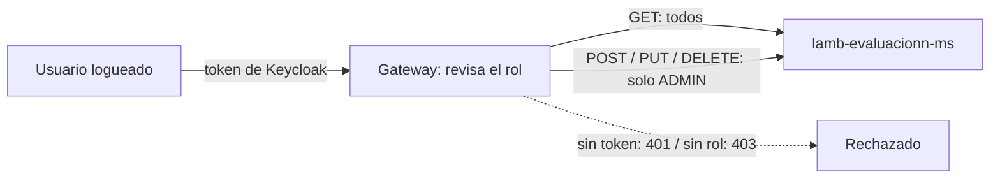

# S7 - Seguridad distribuida y control de acceso

*Guía única: agregar un microservicio nuevo al proyecto Lamb - Parte 7 de 16 - 2026*

!!! note "Antes de empezar: debe estar levantado"
    Desde la raíz del proyecto (`Lamb-Modulo02-Admision-Trayectoria`). Si ya está corriendo, no lo arranques otra vez.

    **Docker** (Docker Desktop abierto; se pueden pegar en la misma terminal):

    ```powershell
    docker compose -f keycloak/compose-dev.yml up -d    # Keycloak (tarda ~1 min)
    docker compose -f services/lamb-evaluacionn-ms/compose-dev.yml up -d    # BD de tu servicio
    ```

    **Servicios** (cada uno en **su propia terminal**, en este orden, esperando que diga `Started ...`):

    ```powershell
    cd infra\lamb-config; .\mvnw.cmd spring-boot:run    # Config Server
    cd infra\lamb-eureka; .\mvnw.cmd spring-boot:run    # Eureka
    cd services\lamb-evaluacionn-ms; .\mvnw.cmd spring-boot:run    # Tu servicio
    cd infra\lamb-gateway; .\mvnw.cmd spring-boot:run    # Gateway (al final)
    ```

    Comprueba que responden:

    - Keycloak: http://localhost:18180/realms/lamb
    - BD de tu servicio: `docker ps` → `lamb-postgres-evaluacionn-dev` *Up*
    - Config Server: http://localhost:18888/lamb-evaluacionn-ms/dev
    - Eureka: http://localhost:18761
    - Tu servicio: http://localhost:8095/actuator/health
    - Gateway: http://localhost:18080/actuator/health

    El Gateway y tu servicio se reinician en esta sesión, después de cambiar el código.

## 1. Introducción

Hasta ahora todo estaba abierto (fase 1). En esta sesión:

1. Tu **servicio** aprende a leer el token de Keycloak (si viene).
2. El **Gateway** decide quién puede hacer qué según el **rol** del usuario, igual que el Gateway de Pagatu:
   **ver = cualquiera; crear, editar y eliminar = solo `ADMIN`**.



## 2. El servicio: `config\SecurityConfig.java` (versión final)

Reemplaza **todo** el archivo de la S1 por este (igual que `pagatu-pago-ms`). Es igual para los dos caminos:

**Abre el archivo:** `SecurityConfig.java`  
**En la ruta:** `services\lamb-evaluacionn-ms\src\main\java\pe\edu\upeu\lamb\evaluacionn\config\`  
**Ojo:** Es el de **tu servicio** (el que creaste en la S1), **no** el del Gateway.  
**Borra todo su contenido y pega el siguiente código:**

{{lamb:services/lamb-biblioteca-ms/src/main/java/pe/edu/upeu/lamb/biblioteca/config/SecurityConfig.java}}

!!! note "Copia tal cual (solo cambia el `package`)"
    `oauth2ResourceServer(... jwt ...)` valida la firma del token usando el `issuer-uri` que pusiste en la S2.
    Las reglas por rol **no van aquí**: van en el Gateway.

## 3. El Gateway: reglas por rol

**Abre el archivo:** `SecurityConfig.java`  
**En la ruta:** `infra\lamb-gateway\src\main\java\pe\edu\upeu\lamb\gateway\config\`  
**Qué hacer:** Este es el del **Gateway** (no el de tu servicio). Busca (`Ctrl+F`) `/api/v1/evaluacionn/**` → **borra** la línea `...permitAll()` que pegaste en la S4 → en ese mismo lugar pega las líneas de tu camino (A **o** B). No borres lo demás del archivo.


### Camino A - Sin CRUD

```java
                        .requestMatchers(HttpMethod.GET, "/api/v1/evaluacionn/**").permitAll()
                        .requestMatchers(HttpMethod.POST, "/api/v1/evaluacionn/**").hasRole("ADMIN")
```

### Camino B - Con CRUD

```java
                        .requestMatchers(HttpMethod.GET, "/api/v1/evaluacionn/**", "/api/v1/examenes/**").permitAll()
                        .requestMatchers(HttpMethod.POST, "/api/v1/evaluacionn/**", "/api/v1/examenes/**").hasRole("ADMIN")
                        .requestMatchers(HttpMethod.PUT, "/api/v1/examenes/**").hasRole("ADMIN")
                        .requestMatchers(HttpMethod.DELETE, "/api/v1/examenes/**").hasRole("ADMIN")
```

Guarda (`Ctrl+S`) y **reinicia el Gateway**: en su terminal `Ctrl+C` y otra vez `.\mvnw.cmd spring-boot:run`.
Reinicia también **tu servicio** (cambiaste su `SecurityConfig`).

**Cambia según lo que te pidan:**

| Te piden... | Usa |
|---|---|
| "todos pueden ver" | `.permitAll()` |
| "solo usuarios logueados pueden ver" | `.authenticated()` |
| "solo el administrador modifica" | `.hasRole("ADMIN")` |
| "administrador y coordinador modifican" | `.hasAnyRole("ADMIN", "COORDINADOR")` |
| "los docentes también" | `.hasAnyRole("ADMIN", "COORDINADOR", "DOCENTE")` |

Roles que ya existen en el realm `lamb`: `ADMIN`, `COORDINADOR`, `DOCENTE`, `ESTUDIANTE`
(para crear otro, ver [S7b](S07b_Seguridad_Distribuida_Keycloak.md)).

!!! note "El orden importa"
    Spring revisa las reglas de arriba hacia abajo y usa **la primera que coincide**. Por eso tus líneas van
    **antes** de `.anyRequest().authenticated()`.

## 4. Probar

Sin iniciar sesión (PowerShell):

```powershell
Invoke-RestMethod http://localhost:18080/api/v1/evaluacionn/saludo                 # 200: GET es libre
Invoke-RestMethod -Method Post http://localhost:18080/api/v1/evaluacionn/saludo    # 401: no hay token
```

!!! note "El POST de arriba da 401 aunque aún no exista"
    El Gateway corta la petición **antes** de llegar a tu servicio. El endpoint `POST .../saludo/evento` se crea en la S8.

**Camino B:**

```powershell
Invoke-RestMethod http://localhost:18080/api/v1/examenes                            # 200
Invoke-RestMethod -Method Post http://localhost:18080/api/v1/examenes -ContentType "application/json" -Body '{"titulo":"x"}'   # 401
```

Con usuarios reales se prueba desde el frontend en la S11:

| Usuario | Al crear / editar / eliminar |
|---|---|
| `admin` / `admin123` (rol `ADMIN`) | funciona |
| `estudiante1` / `estudiante123` | "No tienes permiso para esta acción." (`403`) |

!!! note "Archivos de esta sesión"
    **Reemplazas:**

    - `services\lamb-evaluacionn-ms\src\main\java\pe\edu\upeu\lamb\evaluacionn\config\SecurityConfig.java` - versión final con Keycloak

    **Modificas:**

    - `infra\lamb-gateway\src\main\java\pe\edu\upeu\lamb\gateway\config\SecurityConfig.java` - quitas el `permitAll()` de la S4 y pones las reglas por rol

## 5. Evidencia de cierre de la S7

- `GET` responde `200` sin token; `POST` (y en el camino B `PUT`/`DELETE`) responde `401` sin token.
- Captura de las líneas que agregaste en el `SecurityConfig` del Gateway.

Siguiente: [S7b - Seguridad con Keycloak](S07b_Seguridad_Distribuida_Keycloak.md).
